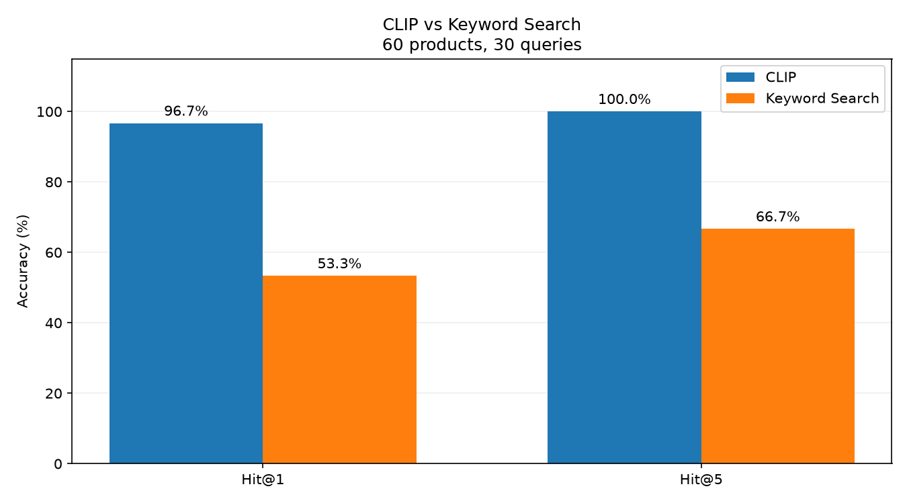
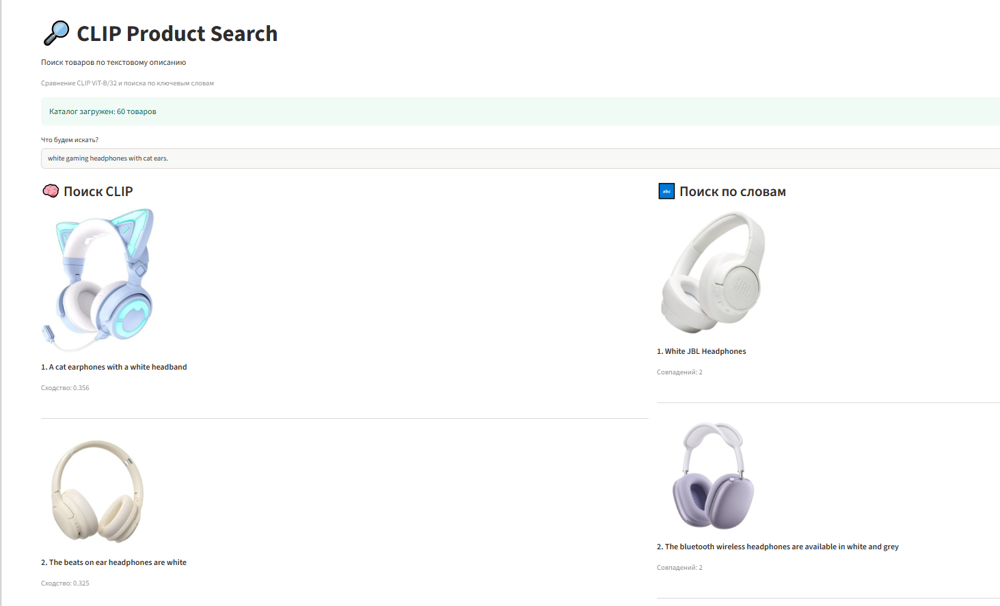

#  CLIP Product Search

**Поиск товаров по текстовому описанию с использованием CLIP ViT-B/32**

Учебный ML-проект, в котором реализован поиск товаров по фотографиям с помощью мультимодальной нейронной сети CLIP.

Пользователь вводит текстовый запрос на английском языке, например `a pair of black sneakers`, а система возвращает наиболее подходящие изображения.

В проекте также реализован обычный поиск по ключевым словам для сравнения качества двух подходов.

##  Цель проекта

Разработать прототип системы поиска товаров по текстовому описанию и сравнить эффективность CLIP с традиционным поиском по словам.

**Задачи:**
- Собрать датасет из 50–100 фотографий товаров.
- Использовать предобученную модель CLIP ViT-B/32.
- Реализовать поиск по текстовому запросу.
- Реализовать поиск по ключевым словам.
- Оценить качество обоих алгоритмов.
- Создать веб-интерфейс для демонстрации результатов.

##  Используемые технологии

- **Python 3.11** — основной язык программирования.
- **PyTorch** — работа с нейронными сетями и тензорами.
- **CLIP ViT-B/32** — получение текстовых и визуальных эмбеддингов.
- **BLIP** — автоматическая генерация описаний изображений.
- **Hugging Face Transformers** — загрузка предобученных моделей.
- **Streamlit** — веб-интерфейс приложения.
- **Matplotlib** — визуализация результатов.
- **CSV** — хранение каталога товаров и результатов оценки.

##  Принцип работы

### Поиск с помощью CLIP

1. Изображения товаров обрабатываются моделью CLIP.
2. Для каждого изображения вычисляется эмбеддинг размерности 512.
3. Эмбеддинги сохраняются в локальный файл.
4. Пользователь вводит текстовый запрос.
5. CLIP преобразует запрос в текстовый эмбеддинг.
6. Вычисляется косинусное сходство между текстовым вектором и векторами изображений.
7. Пользователь получает пять наиболее подходящих товаров.

### Обычный поиск

Для сравнения реализован поиск по ключевым словам.

Алгоритм ищет совпадения слов в названиях и описаниях товаров, сохранённых в `catalog.csv`.

В основном эксперименте технические названия файлов не учитываются.

##  Датасет

Для эксперимента собран набор из **60 фотографий товаров** шести категорий:

- Кружки
- Кроссовки
- Сумки
- Наушники
- Часы
- Рюкзаки

Для автоматического создания текстовых описаний использовалась предобученная модель BLIP.

Датасет включает изображения разных цветов, форм, материалов и ракурсов.

##  Результаты эксперимента

Сравнение выполнено на 60 изображениях и 30 тестовых запросах.

| Метрика | CLIP | Keyword Search |
|---|---:|---:|
| Hit@1 | **96,7%** | 53,3% |
| Hit@5 | **100%** | 66,7% |

**Hit@1** — доля запросов, для которых ожидаемый товар находится на первом месте.

**Hit@5** — доля запросов, для которых ожидаемый товар входит в первые пять результатов.

### Визуализация результатов



### Анализ результатов

В проведённом эксперименте CLIP показал более высокое качество поиска, чем алгоритм совпадения ключевых слов.

CLIP успешно обрабатывал запросы с описанием визуальных признаков товаров и формулировки, которые не полностью совпадали с текстом каталога.

Обычный поиск сильнее зависел от используемых слов и качества автоматически созданных описаний BLIP.

### Ограничения

- Эксперимент проводился на небольшом наборе из 60 изображений.
- Тестовые запросы подбирались с учётом содержимого датасета.
- Для каждого запроса был заранее определён один ожидаемый товар.
- Ошибки BLIP могли снижать качество поиска по словам.
- Результаты не доказывают превосходство CLIP на любых наборах данных.

##  Установка и запуск

Рекомендуемая версия — Python 3.11.

**1. Клонировать репозиторий**

Скачать проект с GitHub и открыть папку в терминале.

**2. Создать виртуальное окружение**

```powershell
py -3.11 -m venv .venv
```

**3. Установить зависимости**

```powershell
.\.venv\Scripts\python.exe -m pip install -r requirements.txt
```

Для установки PyTorch под конкретную видеокарту можно использовать инструкции на [официальном сайте PyTorch](https://pytorch.org/get-started/locally/).

**4. Подготовить изображения и каталог**

Поместить фотографии в папку `Images` и создать `catalog.csv` со столбцами `filename`, `title`, `description`.

Названия в `filename` должны совпадать с реальными файлами.

**5. Создать эмбеддинги**

```powershell
.\.venv\Scripts\python.exe create_embeddings.py
```

**6. Запустить приложение**

```powershell
.\.venv\Scripts\python.exe -m streamlit run app.py
```

Приложение будет доступно по адресу:

`http://localhost:8501`

При первом использовании предобученные модели скачиваются из Hugging Face.

##  Оценка качества

Для проведения эксперимента необходим файл `test_queries.csv` со столбцами `query` и `expected_filename`.

Запуск оценки:

```powershell
.\.venv\Scripts\python.exe evaluate_search.py
```

Результаты сохраняются в файл `evaluation_results.csv`.

##  Возможные улучшения

- Поддержка запросов на русском языке.
- Расширение датасета.
- Использование более качественных описаний товаров.
- Улучшение алгоритма поиска по ключевым словам.
- Добавление фильтров по категориям и характеристикам.
- Оценка поиска на независимом тестовом наборе.

##  Вывод

В рамках проекта разработан рабочий прототип поиска товаров по текстовому описанию с использованием CLIP ViT-B/32.

Система позволяет находить изображения по смысловому сходству с запросом, отображать результаты через веб-интерфейс и сравнивать их с обычным поиском по ключевым словам.

В проведённом учебном эксперименте CLIP показал более высокие значения Hit@1 и Hit@5, продемонстрировав возможности мультимодальных моделей для поиска изображений.